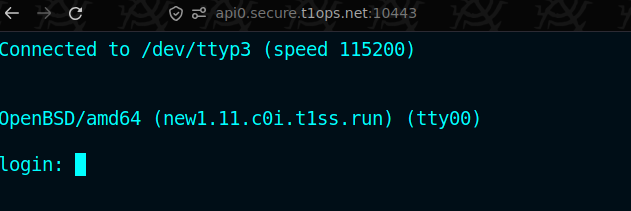

# Kybornos API client utils

API usage examples with cURL can be found under `curl/`. These assume the `API` and `API_KEY` is exported.

Example:

```shell
export API=https://api.internal.kybornos.com:8443
export API_KEY=1234567890
```

## Listing VMs:

``` shell
$ kybr_list
ID                                    CPUS  MEMORY  DISK     STATE    PUBLIC  IP          NAME
01a133e6-4ff6-70fe-9d47-c5d367871cba  4     4096M   81920M   running  false   10.0.11.9   89BB157AB478.db0
01a133e7-497e-7c60-9fc9-beda12ae4a39  8     8192M   163840M  running  false   10.0.11.11  B6612B4AE0A2.giant0
01a133e7-ceb5-798e-9435-3ab64ac0bba1  1     1024M   20480M   running  false   10.0.11.12  999DA04A45A8.small0
01a18863-a5c4-7260-af2a-a4cb1c89d3f6  1     1024M   20480M   running  false   10.0.11.13  1790459DBC65.new0
```

## Deploy VM:

``` shell
cat > vm.json
{
  "name": "new1",
  "size": "large",
  "autoinstall": {
    "username": "dave"
  }
}

$ kybr_deploy vm.json
{
  "data": "01a18d26-a2d8-7657-bbb6-7cf9e2732913",
  "status": "ok"
}
$ kybr_list
ID                                    CPUS  MEMORY  DISK     STATE       PUBLIC  IP          NAME
...
01a18d26-a2d8-7657-bbb6-7cf9e2732913  4     4096M   81920M   configured  false   10.0.11.14  70125AA67FFD.new1
```

`configured` state means the VM is currently auto-installing.

Once auto-install is complete the state becomes `running`:

``` shell
$ kybr_list
ID                                    CPUS  MEMORY  DISK     STATE    PUBLIC  IP          NAME
...
01a18d26-a2d8-7657-bbb6-7cf9e2732913  4     4096M   81920M   running  false   10.0.11.14  70125AA67FFD.new1
```

## Start serial console

``` shell
$ kybr_console 01a18d26-a2d8-7657-bbb6-7cf9e2732913
{
  "status": "ok"
}
```

After this open the browser at https://api0.secure.t1ops.net:10443 to access the VM's serial console:


